# DeskBuddy

**A little pixel-art robot that lives on your desk.** He has moods, reacts when you tap him, asks whether you fancy a
smoke break, plays games with you and turns into a desk clock when you need one. A Windows app lets you send him
messages, plan his week and keep a journal of your day.

<p align="center">
  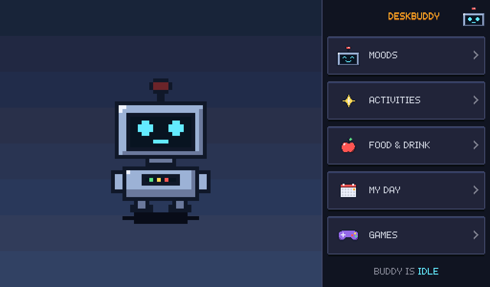
</p>

DeskBuddy runs on a [Waveshare ESP32-S3-Touch-LCD-7B](https://www.waveshare.com/wiki/ESP32-S3-Touch-LCD-7B), a
7-inch 1024×600 touchscreen with an ESP32-S3. Buddy lives on the left; on the right is a touch menu built for a
finger. Everything is drawn in pixel art by DeskBuddy's own small rendering engine.

## Meet Buddy

He always has a mood, and it shows. Pick one on the touchscreen or in the Windows app; the other side follows.

<table>
  <tr>
    <td align="center">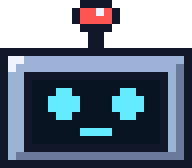<br><b>Idle</b><br><sub>breathing, blinking</sub></td>
    <td align="center"><br><b>Relaxed</b><br><sub>slow and content</sub></td>
    <td align="center">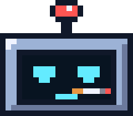<br><b>Peukie</b><br><sub>a smoke break</sub></td>
    <td align="center">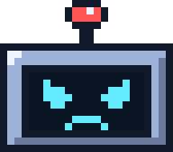<br><b>Angry</b><br><sub>steam and fury</sub></td>
    <td align="center">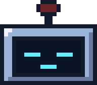<br><b>Sleepy</b><br><sub>nodding off, Zs</sub></td>
    <td align="center">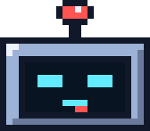<br><b>Working</b><br><sub>tongue out, sweating</sub></td>
    <td align="center">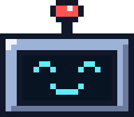<br><b>Happy</b><br><sub>hops and sparkles</sub></td>
  </tr>
</table>

He also has short shows that play on top of his mood: he drinks **Water** (and short-circuits), **Sneezes** his head
off, loses a **Staring** contest, **Meditates** until a notification drops him, and builds a grand plan in
**Focus** until someone asks "do you have 1 sec?". And he can turn into **KITT**.

## Things he does

<table>
  <tr>
    <td width="50%">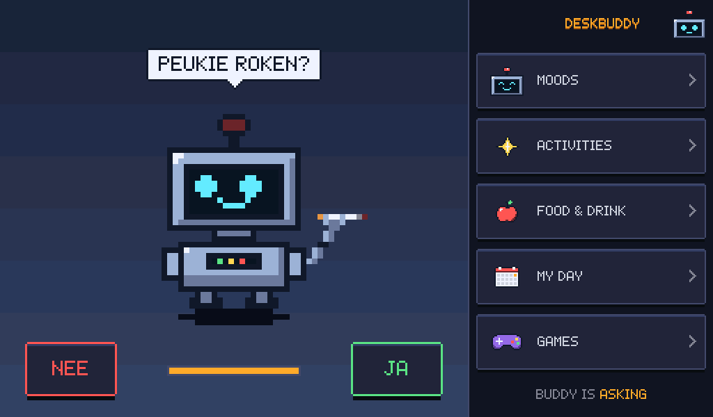</td>
    <td width="50%">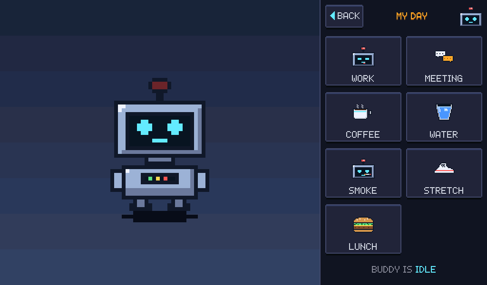</td>
  </tr>
  <tr>
    <td><b>He asks you things.</b> <i>Peukie roken?</i> Answer <i>JA</i> and he happily joins you for a smoke break; answer <i>NEE</i> and he sulks for a moment.</td>
    <td><b>MY DAY.</b> Tell him what you're up to (coffee, a meeting, lunch) and he cheers you on. The Windows app turns your taps into a journal of your day.</td>
  </tr>
  <tr>
    <td>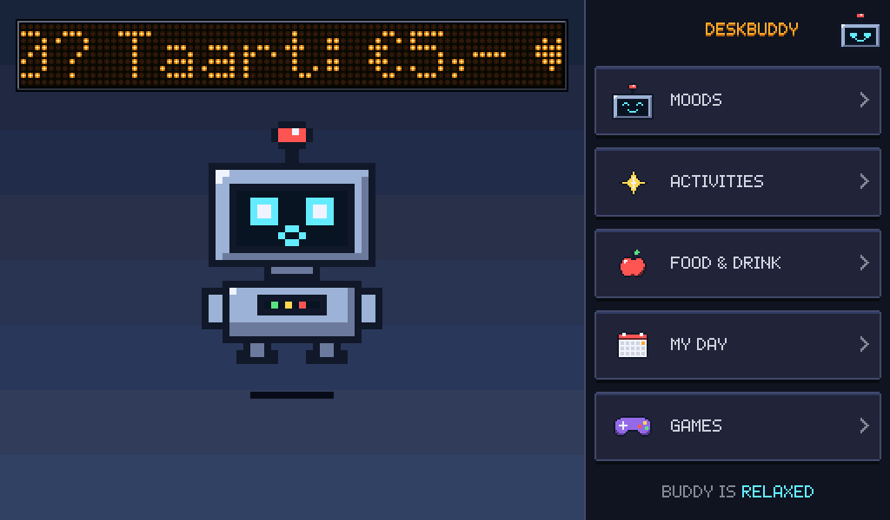</td>
    <td>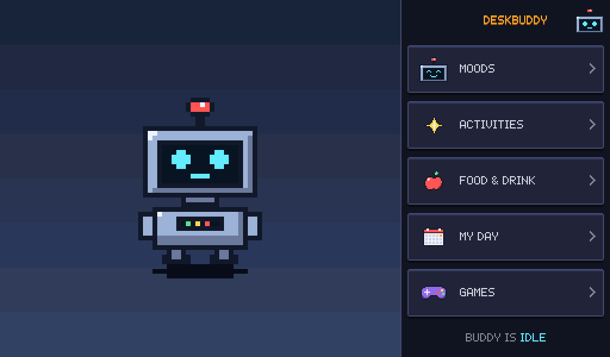</td>
  </tr>
  <tr>
    <td><b>Messages</b> sent from your PC scroll across a retro LED sign above his head.</td>
    <td><b>The menu:</b> moods, activities, food &amp; drink, MY DAY and games, all a tap away.</td>
  </tr>
</table>

## Clock Mode

Tap his head and he walks up to you until his face fills the screen, closes his eyes, and becomes a desk clock. Tap
again and he steps back. There are two faces: *Classic* and the steampunk *Mechanical Skeleton*, whose gears tick,
roll and whir on the hour.

<p align="center">
  
</p>

<table>
  <tr>
    <td width="50%">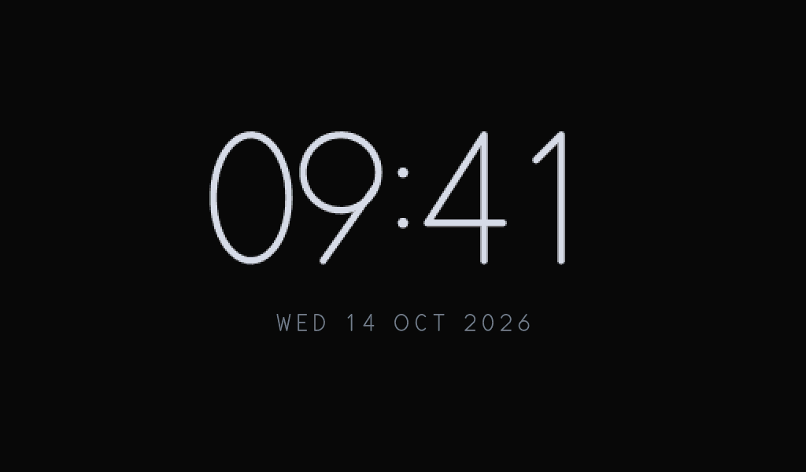</td>
    <td width="50%">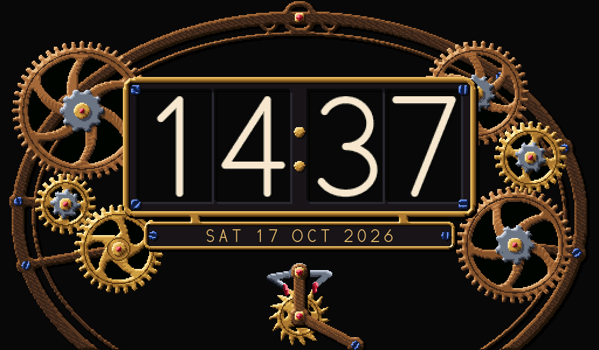</td>
  </tr>
</table>

## Games

<table>
  <tr>
    <td width="50%">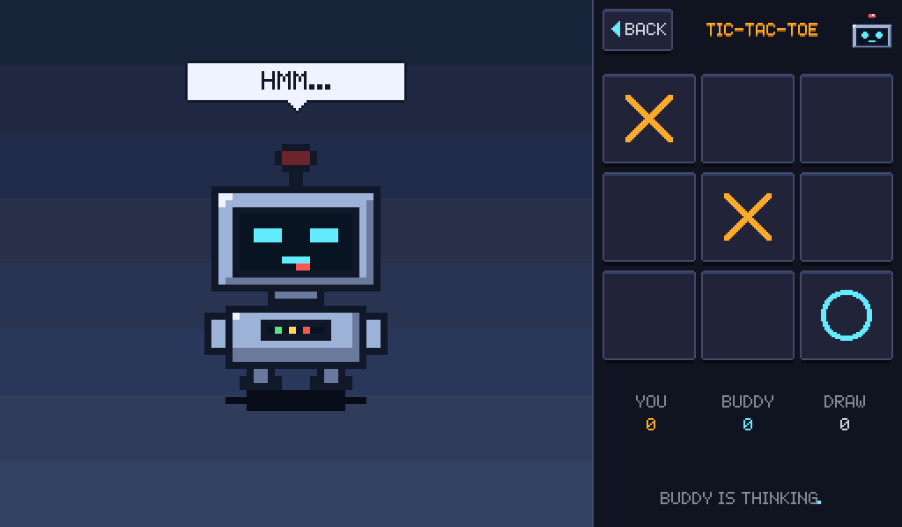</td>
    <td width="50%">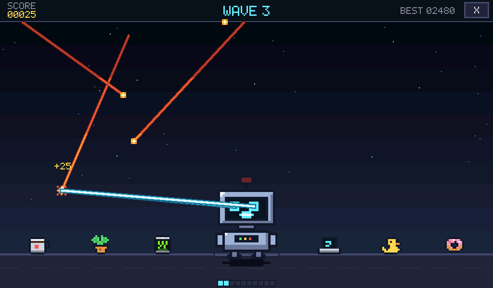</td>
  </tr>
  <tr>
    <td><b>Tic-Tac-Toe.</b> Buddy is good but beatable. He gets smug when he wins and sulks when he loses.</td>
    <td><b>Buddy Missile Defense.</b> Tap the sky and he fires his eye lasers. Protect his coffee, his plant, the rubber duck and the Monster can.</td>
  </tr>
</table>

## The Windows app

**DeskBuddy Control Center** connects to Buddy over USB. It sets his clock, picks his mood, starts his shows, sends
messages, runs a weekly schedule and keeps a history of what he did and what you told him.

<table>
  <tr>
    <td width="50%">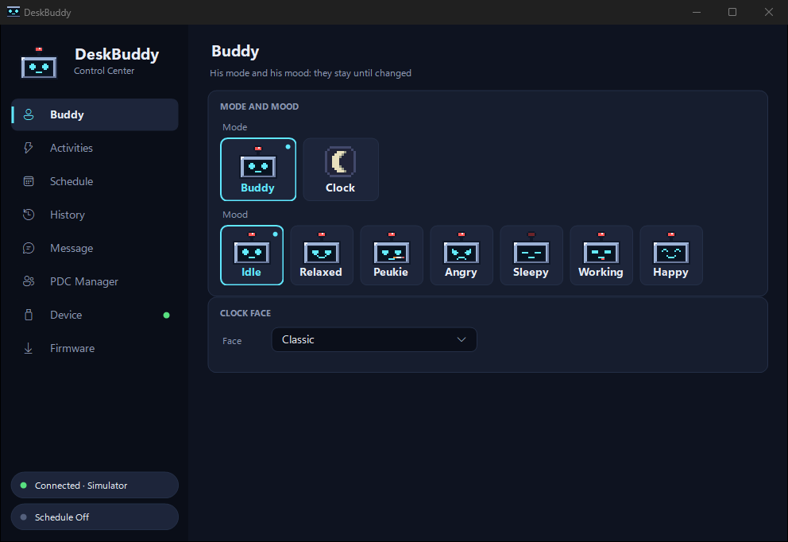</td>
    <td width="50%">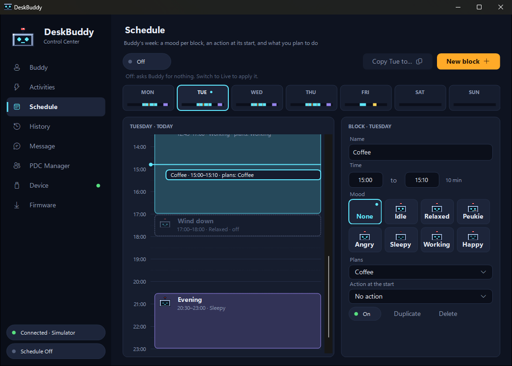</td>
  </tr>
  <tr>
    <td><b>Buddy:</b> his mode, his mood and the clock face.</td>
    <td><b>Schedule:</b> plan his week in blocks: a mood, an action at the start, what you plan to do.</td>
  </tr>
  <tr>
    <td>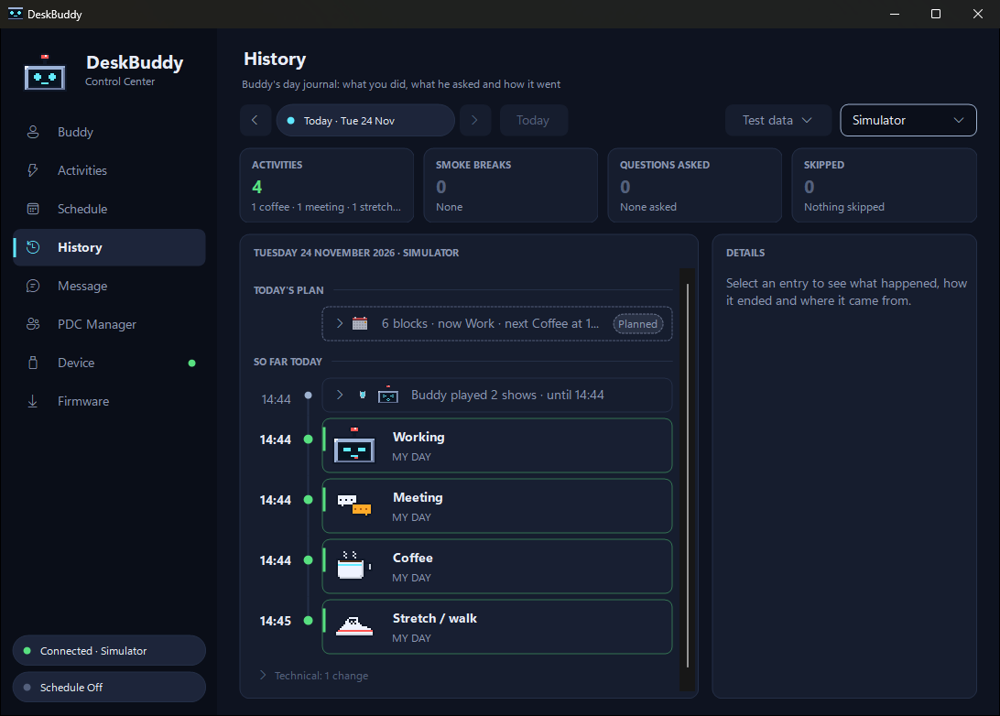</td>
    <td>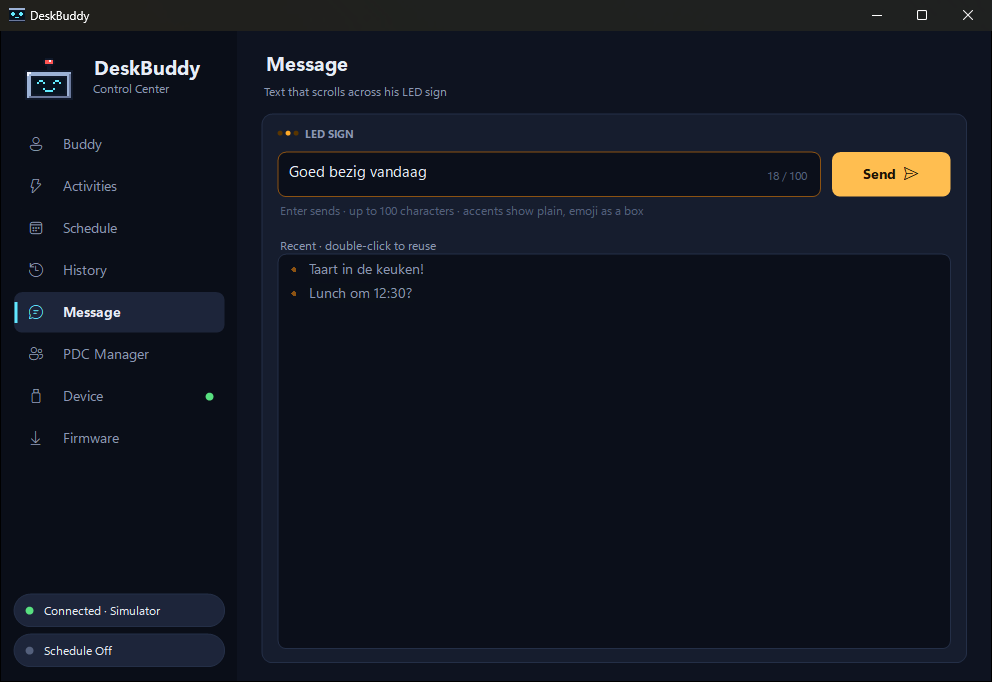</td>
  </tr>
  <tr>
    <td><b>History:</b> your day as Buddy's journal, with his questions and your answers.</td>
    <td><b>Message:</b> type it, press Enter, watch it scroll.</td>
  </tr>
</table>

Optionally it shows your Claude usage and this PC's load as small strips under Buddy. It also updates his firmware
(signed packages, with a backup first), can live in the notification area and start with Windows. Details: [docs/companion.md](docs/companion.md).

## Getting started

You need the Waveshare ESP32-S3-Touch-LCD-7B, a USB-C cable (use the port labelled **UART**) and a Windows PC.

```powershell
git clone https://github.com/neil2222/deskbuddy.git
cd deskbuddy
tools\setup-idf.ps1                                  # once: ESP-IDF (the ESP32 toolchain)
tools\idf.ps1 -C firmware\deskbuddy build flash      # build the firmware and put it on the board
tools\setup-dotnet.ps1                               # once: .NET SDK for the Windows app, no admin rights needed
tools\companion.ps1 -Publish                         # companion\publish\DeskBuddy.Companion.exe: double-click it
```

**No board?** The desktop simulator runs the same code in a window on your PC, with the mouse as your finger, and the
Windows app connects to it: `tools\simulator.ps1`, or *Device → Build and start* in the app. The screens of Buddy on
this page come from the simulator and from the snapshot renderer in the host tests, which run the board's own code.

Full setup, build options, tests and the code layout: [docs/development.md](docs/development.md).

## Status

A personal hobby project. Buddy is still a placeholder character (the real design
comes later); the board keeps no settings across restarts (the Windows app restores the clock, mood and clock face
when it connects, and keeps the history). There is an optional integration with a workplace tool (PDC Manager's
*Ze Doen Maar Wat* button) that is off by default.

## Documentation

| Document | What's in it |
|---|---|
| [What Buddy does](docs/features.md) | The touchscreen menu, moods, activities, Clock Mode and games in detail |
| [Windows app](docs/companion.md) | Every page of the Control Center |
| [Daily use](docs/daily-use.md) | Running it every day on a laptop: install, data, backup and restore |
| [Development](docs/development.md) | Setup, building and flashing, the simulator, host tests, the factory firmware backup |
| [Hardware](docs/hardware.md) | The Waveshare board: pins, timings, quirks |
| [Protocol](docs/protocol.md) | The USB serial protocol between the board and the app |
| [Schedule and history](docs/schedule.md) | How the weekly schedule and the history work |
| [Firmware packages](docs/firmware-packages.md) | Versions, signed packages and the Firmware Manager |
| [Handover](HANDOVER.md) | Where the project stands, the decisions behind it and what comes next |

## License

[MIT](LICENSE). Third-party components keep their own licences: the esptool the Windows app embeds for flashing is
GPL-2.0-or-later, see [companion/third_party/esptool](companion/third_party/esptool/README.md).
