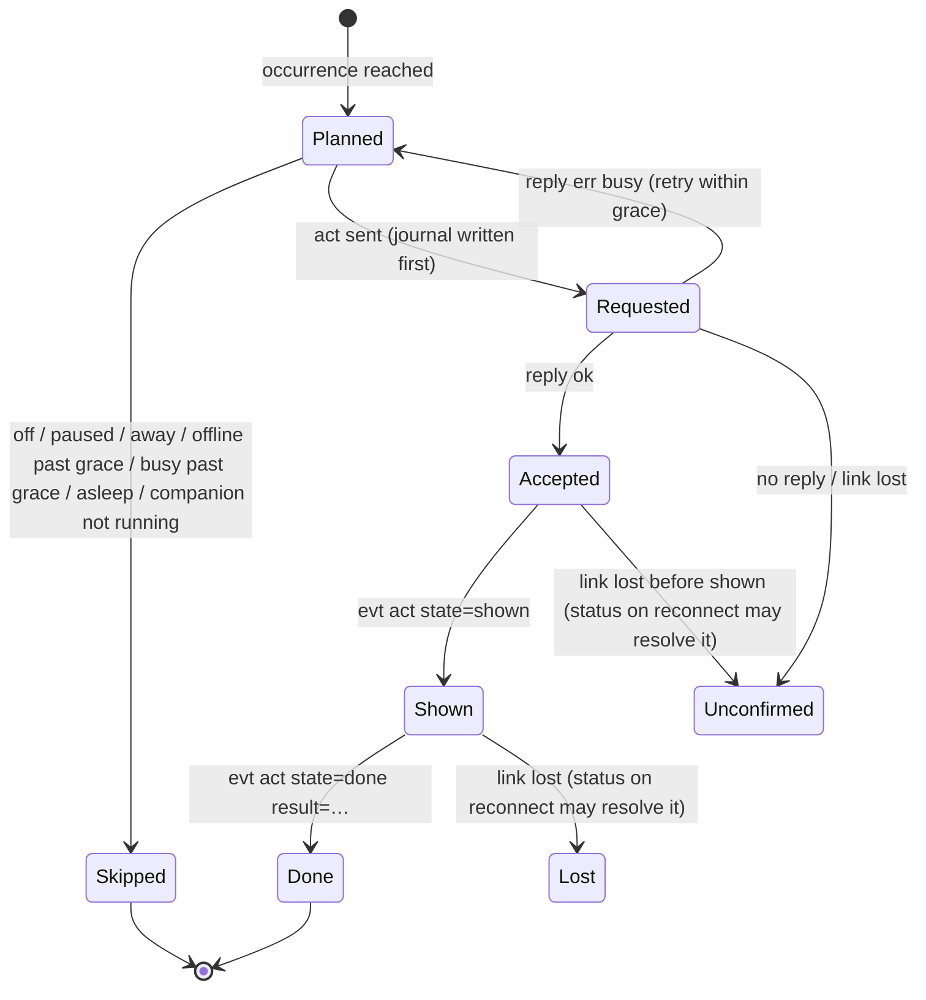

# Schedule, interactions and history: design

Status: P1–P3 built on `feature/schedule` (engine, `schedule.json`, the Schedule page with drag-and-drop). Everything
below "P4" is design, approved direction but not built. The Companion is the scheduling brain; firmware and
simulator only show, ask and report (they share `components/app`, so every protocol addition lands in both).

## 1. Three separate concepts

| Concept | Meaning | Who acts | Evidence of real life? |
|---|---|---|---|
| **Mood** | How Buddy looks during an interval (`working`, `sleepy`, …) | Buddy (device) | Never |
| **Action** | Something Buddy does at a moment: an animation, or an interactive question with an answer | Buddy (device), started by the schedule | Only the answer to an interactive question, and only once it was confirmed on screen |
| **Plan** | What you intend to do (`smoke`, `coffee`, `meeting`, …) | Nobody: an intention | Never; compared with actual history later |

A block may have any combination. Real-world activity is recorded only from explicit statements: an answer to a
question, a MY DAY tap on the touchscreen, a Companion quick-log button. Buddy's entertainment shows (Activities,
Food & Drink animations) never create history.

### Block (schedule.json, version 2)

```json
{"id": "…", "name": "Smoke break", "start": "10:00", "end": "10:12",
 "mood": null, "action": "ask_peukie", "plans": "smoke", "reminder": false, "enabled": true}
```

`action` is new (null: none). It fires once, at the block's start (see §4). Version 2, because a version-1 Companion
would drop `action` when it saves; a v1 file loads into v2 unchanged.

### Scheduled actions: an allowlist in the Companion

| id | Kind | Sent as | Results |
|---|---|---|---|
| `ask_peukie` | interactive question (the existing "PEUKIE ROKEN?", same code path as the touchscreen menu) | `act name=ask_peukie iid=…` | `yes`, `no`, `timeout` |
| `sneeze`, `stare`, `meditate`, `focus`, `water` | animation | `act name=… iid=…` | `done`, `interrupted` |

Only ids in this list can be stored in `action` and sent by the scheduler. PDC Manager, Teams, messages, mode
changes and anything else with an external effect are not in it, and the device has no command that could do them
from `act` anyway.

## 2. Protocol additions (P4)

All backward compatible: unknown arguments and events are ignored on both sides; the Companion checks `hello caps=`.

| Addition | Purpose |
|---|---|
| `act name=<n> iid=<1..4294967295>` | `iid` correlates the request with what follows. Reply `ok` = started on the device this frame; `err busy mode=<m>` = not started (Clock Mode, a zoom, another activity or question, screen not lit) |
| `acts=` gains `ask_peukie` | The existing question can be started by command (today: touchscreen only) |
| `evt act iid=<n> name=<a> state=shown src=<cmd\|touch>` | Sent after the first frame showing it has been presented: the question is really on screen |
| `evt act iid=<n> state=done result=<yes\|no\|timeout\|done\|interrupted>` | The end. `timeout` and `no` are distinct (the brain knows whether the minute ran out or NEE was pressed), although Buddy reacts the same way to both |
| `status` gains `act=<iid>:<state>[:<result>]` | The current or last interaction, so a reconnect can close a record whose events were lost |
| `evt mood … src=<cmd\|touch\|timer\|break>` | Why the mood changed: a manual override is then a rule, not a guess |
| `evt did item=<menu item id>` | MY DAY taps (explicit activities); never sent for things the Companion commanded |
| cap `track` | The firmware does the above; without it the Companion schedules no actions (moods only) |
| P4.1, cap `log`: `dev=`/`boot=` in `hello` and `evt boot`; `seq=` and `t=<UTC ms>` or `up=<ms>` on `evt act` and `evt did`; `log.since boot= seq=` | Events from while the Companion was away come back after a reconnect, each with a permanent identity and its own time (see `docs/protocol.md`, *Recorded events*) |

Touch-started questions get an iid from the device (top bit set), so the device's and the Companion's ids never
collide. The question keeps its **60 s** window (`BUDDY_ASK_MS`; decided). Approved: grace periods of 3 min for
questions and 1 min for animations; the scheduled-action allowlist above (Monster stays out); the four Pause presets.

## 3. Interaction lifecycle and records



**Files (P5, `%APPDATA%\DeskBuddy`; the simulator's have `.sim` before the extension):**

| File | Holds | Written |
|---|---|---|
| `device-events.jsonl` | The canonical device log: `event` (one per `(dev, boot, seq)`), `boot` (first seen), `gap` (overflow, count known), `boot_end` (`seen_live` true/false; never a claim of completeness) | Append-only, flushed to disk per batch |
| `device-checkpoints.json` | Per `(dev, boot)`: the contiguous checkpoint | Replaced atomically, after the log lines it covers |
| `companion-events.jsonl` | The Companion's own facts: `request` (an `act` it sends, with iid, action, origin; written before sending) and `request_result` (`ok`, `dup`, `busy`, `unsupported`, `err:<code>`, `no_reply`, `lost`) | Append-only |
| `installation.json` | This installation's stable id (GUIDv7), carried by every line | Once |

```json
{"v":1,"kind":"event","dev":"441bf68d1178","boot":"3b765ad715085c07","seq":2,"name":"act",
 "payload":"evt act iid=2001 state=done result=yes seq=2 t=1792097124747","time_known":true,
 "t_utc":"2026-10-15T20:45:24.747+00:00","up_ms":null,"src":"board","recv_utc":"…","recv":"…+02:00",
 "tz":"W. Europe Standard Time","inst":"<installation id>"}
```

**Interactions and activities are derived, not stored:** they are folded from these files on loading and after every
change (`HistoryDeriver`), with ids that are pure functions of their source (`<dev>/<boot>/i<iid>`,
`<dev>/<boot>/<seq>`, `<interaction id>/smoke`). A replay, a restart or a rebuild therefore yields the same records;
there is nothing to deduplicate. A record holds:
- **Interaction:** iid, action, origin (`touchscreen` from `src=touch`; `companion` / `scheduled` from the journal;
  `command` for an unrecorded command; `unknown` when `shown` never arrived), shown (only from `state=shown`; an
  accepted command is not shown), shown and end time (device time), outcome (`yes`, `no`, `timeout`, `interrupted`,
  `done` for shows, `not_started` when the device refused the request, else `unknown`), request time and result.
- **Activity:** type, started_at (device time: UTC or uptime only), optional ended_at (only from an explicit end;
  none yet), via (`myday:<item>` or `interaction:<id>`).

**Outcomes and what they may mean later:**

| Outcome | Counts as behaviour? |
|---|---|
| `yes`, `no` (shown) | yes |
| `timeout` (shown) | yes, but weaker: you may not have been at the desk |
| `done`, `interrupted` (animations) | no (Buddy's show) |
| `skipped:<reason>`, `unconfirmed`, `lost`, `not_started`, `unknown` | no: an offline device, a pause or a busy Buddy is not you ignoring him |

**No duplicates:**
- The `request` line is written before `act` is sent (P5 for Activities tiles; P6 for the schedule).
- The occurrence id is checked before every attempt, so a restart, reconnect or retry never sends twice (P6).
- Events are stored by `(dev, boot, seq)`; derived records have deterministic ids.

**Activities:**
- Every MY DAY tap (`evt did`) is one activity of its type.
- *JA* to the question is one `smoke` activity at the answer time, linked to the interaction (`interaction:<id>`),
  however often its events arrive.
- A MY DAY "Smoke" is a separate record: a different source of evidence.
- Moods and Buddy's shows are never activities. `ended_at` stays empty until there is an explicit end.

### The History view (P7.1: `History/HistoryView.cs`, `History/HistoryAnnotations.cs`)

A pure projection of one source's snapshot, log and annotations; the records above are not changed.

| Entry | From | Time |
|---|---|---|
| Activity (MY DAY) | `ActivityRecord` via `myday:` | `started_at` |
| Question | an `ask_*` interaction; its YES smoke break is `Linked`, not a second entry | shown, else ended, else the request |
| Show | any other interaction (collapsed in the UI; never an activity) | idem |
| Skipped | an occurrence with a skip (a busy-then-skipped request appears once, as skipped) | planned time |
| Notice | a gap (`n` recorded entries lost): explains missing entries | receipt |

- Status words: Yes, No, Timed out, Interrupted, Played, Not started, Unconfirmed, No outcome received (shown, no
  `done`), Not shown (accepted, never confirmed shown). "Displayed" only after a confirmed `shown`.
- Days are local calendar days in the current zone (the repeated DST hour stays on its day, in real order).
  Uptime-only entries get no time: they are listed apart on the day they were received, by boot and seq.
- Restarts and schedule-state changes are *technical*: listed apart, not in the timeline.
- Numbers count visible entries only; each activity once (a YES smoke break and a MY DAY smoke are two).
- Today's plan comes from the current schedule and only for today; older days are never reconstructed from it.
- **Annotations** (`history-annotations.jsonl`, `.sim` for the simulator; append-only): `hide` an item (interaction,
  activity or occurrence id) or a period (UTC from–to; uptime-only entries by receipt), `unhide` withdraws a hide by
  its id. Hiding a question hides its smoke break and occurrence; a smoke break can be hidden alone. `Affected`
  previews what a period would hide before anything is written. The canonical logs are never touched.
- **Journal additions (P7):** `block_name` on scheduled requests and skips; `schedule_state` lines (`live`,
  `paused_until`) when the switch or the pause changes (not repeated after a restart).

### The History page (P7.2: `HistoryPage.cs`, `History/HistoryJournal.cs`, `UI/HistoryControls.cs`)

Buddy's day journal, between Schedule and Message in the sidebar. It reads only the recorder's `HistoryState`
(snapshot + projected entries, rebuilt on the recorder's worker after loading and after every change, never changed
afterwards); `HistoryJournal` turns a `HistoryDay` into rows, the four numbers and the inspector's text (pure, tested).

- **Header:** previous / next day, *Today*, the date (a month picker: days with entries have a cyan dot; no future
  days); a *DeskBuddy* / *Simulator* picker only when the simulator has a history (each source its own, never mixed).
- **Numbers:** activities (by type), smoke breaks (after a yes / via MY DAY), questions asked (only confirmed
  `shown`; their answers; *+n not started* / *+n unconfirmed* listed apart), skipped actions (the reason).
- **Journal:** entries one under another in time order with a thin rail, never a proportional 24-hour scale. Cards by
  kind: activities (green, MY DAY art), questions and shows (their outcome as a pill: Yes green, No in Buddy's body blue (a valid answer, never an error colour), Timed out and
  No outcome amber, Unconfirmed / Not started / Not shown grey and dashed), skipped actions (dashed, faded), loss
  notices (amber, dashed). A YES smoke break is a line inside its question. Buddy's shows in a row fold into one line
  (*Buddy played 2 shows*) that opens in place. *Time unknown* lists uptime-only entries without a time (the
  inspector names their arrival as an arrival). *Technical* (restarts, schedule switched / paused) is folded.
- **Today's plan:** today only, from the schedule as it is now, one dashed line (*n blocks · now … · next … at
  HH:mm*, the block in force being the one that started last) that opens to the blocks, each labelled *Planned*.
- **Details:** the selected entry's art, kind, outcome, times, origin (*Scheduled: "block" at HH:mm*, older records
  without a block name *Scheduled at HH:mm*), the linked smoke break and a sentence on what the outcome means;
  ids, boot, seq, request result and receipt time folded under *Technical details*.
- **Live:** a recorder change is shown after 150 ms (a replay burst once); the selection (by entry id), the open
  groups, the inspector's state and the scroll position are kept; the inspector follows its entry (a question that
  gets its answer). Midnight moves a page showing today to the new today.
- **Empty days:** Buddy's sleepy face (*Nothing was recorded on this day*), today his relaxed one with a hint.
- **Cost** (a year of synthetic history, 8.6k events / 6.1k entries): load 110 ms, projection 12 ms per change on the
  worker, a day's rows 1.2–1.4 ms on the UI thread, the month picker's days 3.5 ms.

### Test data (P7.3: `HistoryPage.cs`, `UI/HistoryDialogs.cs`, `HistoryRecorder` annotations)

Hiding is an annotation of the source (`history-annotations.jsonl` / `.sim.jsonl`, §3); the canonical logs, the
journal and the derived history are never changed, and nothing is ever hidden automatically.

- **Hide as test** (the details' button, or the entry's context menu: right click, the menu key, Shift+F10): hides
  the entry by its id; a question takes its linked smoking break and its scheduled occurrence with it. A notice says
  what was hidden, with *Undo*.
- **Test data → Show hidden entries:** hidden entries in the journal, faded with a *Hidden · test* pill (a hidden
  smoking break as a faded line); the day card says *showing hidden*. They never count in the numbers. The details
  say what hides an entry (*on* a date, or *with the period* …, with its note).
- **Restore:** withdraws every hide that keeps the entry hidden. When one is a period, the user is asked first, with
  how many entries the period brings back (*Restore period…*).
- **Test data → Hide a period as test…:** a dialog for one day, from / to (24:00 allowed), an optional note, and a
  live preview: every entry it would hide with its time, the linked smoking break, entries with an unknown time
  (*time unknown, arrived Fri 10:46*), and a summary (*5 entries: 2 questions (1 with its smoking break), 2
  activities, 1 show · 1 with an unknown time*). *Hide n entries* is the explicit confirmation. A period must have
  passed (no future entries are hidden in advance) and its times must exist (spring clock change). Before writing,
  the page checks that the period still covers exactly the previewed entries; otherwise nothing is written.
- **Test data → Hidden entries (n)…:** every hide in force (entry or period, what it covers, its note, when),
  *Restore* per hide (a period after confirming how many entries come back).
- **Writes:** on the recorder's worker; the task completes only after the line is flushed to disk and the new state
  is published. On a failure the store reads back what the file really holds, the page says *Could not save the
  change (…). Nothing was hidden.* (or that the line reached the file anyway), and shows the day from that state.
- **Sources:** the page writes to the source it shows; the board's and the simulator's annotations are separate files.

### Scale and keyboard (P7.5)

- **Text at every scale.** Fonts are in points, which GDI turns into pixels at the *system* DPI (the main screen's
  at sign-in). Text the Companion draws itself (buttons, pills, cards, the timeline, the journal, the details, the
  month, the dialog lists) uses `Theme.At(control.DeviceDpi)`: the same fonts scaled to the control's own screen.
  Native controls are scaled by WinForms. Verified on a real monitor at 125 % and 150 % and after moving the window
  from a 100 % screen to a 150 % one.
- **Window size.** At start and after a move to a screen with another scale the window keeps within that screen's
  work area (size, minimum size: 800 × 560 at 100 %, and position). Lists with fixed rows (the dialogs' entry lists,
  the recent messages) set their row height for their DPI; the month picker is sized for its button's screen.
- **Narrow windows.** In a narrow journal the time column is narrower, the details card may shrink to 200 px, and a
  card without room for its outcome pill leaves it out (the outcome is in its second line).
- **Keyboard.** The month picker: arrows (a day, a week), Page Up / Down (a month), Home (today), Enter or Space
  picks, Escape closes; it gets the focus when it opens. The journal: Up / Down also reach the lines that open (shows,
  today's plan, *Technical*), Enter or Space opens them, the menu key or Shift+F10 opens an entry's menu. *Technical
  details* in the details is reachable with Tab and opens with Enter or Space. Menus opened from a button start on
  their first item; the hide dialogs start on their first field and tab to their buttons last.

## 4. Live scheduling (P6: `CompanionService.Schedule.cs`, `ActionScheduler`, `MoodDirector`)

**Off until switched on.** The Schedule header's switch (*Off* / *Live*, stored as `live` in `schedule.json`
version 2) is off by default; a version 1 file's `enabled` is not taken over, so an existing schedule never goes
live by itself. Off: no scheduled mood or action is sent and nothing is recorded. Switching it on applies the
current scheduled mood (like *Resume*); occurrences planned before that moment that day are left alone.

**Moods** go through `MoodDirector` (§1 rules: latest-started layer wins, a block without mood does not hide the one
below, no forced idle, a manual choice holds until the next actual transition or *Resume*, unchanged boundaries do
not end it, the repeated DST hour does not fire twice). What counts as manual: `evt mood src=touch`, and `src=cmd`
that is not the schedule's own `mood.set` (a mood tile, another tool). `src=timer` and the end of a smoke break let
the director restore what it wants. On connect the device's mood is respected (a non-default mood counts as the
user's choice); transitions missed while away are not replayed. After a device restart the desired mood is applied.

**Actions:** a block may start one of `ask_peukie`, `sneeze`, `stare`, `meditate`, `focus`, `water`
(`ScheduledActions`; never Monster, PDC, Teams, messages or anything with an external effect) at its start time,
through the firmware's `act` (the question is the same 60 s question as on the touchscreen). A planned smoke break or
an action never sets a mood; a block without mood inherits the one below.

**Occurrence id:** `<block id>/<local date>`.
- One action per block per day: a restart, the repeated DST hour or a reconnect cannot run it twice (the first
  02:30 of the fall-back night counts).
- A block starting in the skipped DST hour runs at the first existing minute.
- Moving the block later the same day, before it ran, keeps the id, so it runs at the new time. Once it ran, it does
  not run again that day.

**At the start time:** the occurrence is due for a grace period of 3 minutes for questions and 1 minute for
animations.

| Situation | Decision |
|---|---|
| Schedule off | Nothing (not tracked, not recorded) |
| Paused | `skipped:paused` |
| Device not connected | Wait; if it connects within the grace period, run; else `skipped:offline` |
| Device busy (Clock Mode or its zoom, Monster, an activity, another question, screen dark) | `err busy` from the device: retry every 10 s within the grace period; else `skipped:busy:<mode>`. Nothing is ever interrupted |
| Firmware without caps `track` + `log` or without the act | `skipped:unsupported` (unavailable, not refused) |
| Missed before the Companion started | `skipped:companion_off` once a device connects; never run late |
| The clock jumped over it (PC asleep) | `skipped:asleep` |
| Otherwise | Run now |

**Exactly once:** the `request` line (with `occurrence`, `block`, `planned`, `planned_utc`, `iid`, `origin:
scheduled`) is written and flushed *before* `act` is sent. An occurrence with a request is never sent again unless
its last answer was `busy` or `not_connected` (certainly not run; retried within the grace period, with the same
iid); a request without an answer (a crash), `no_reply` or `lost` is uncertain and is never resent (the interaction
then reads `unconfirmed` unless the device's events, replayed later, tell what happened). While a request is in
flight the occurrence cannot also be skipped. Records go to the journal of the device connected (or connected last);
before the first connection nothing is recorded, so simulator runs and board history never mix.

Old questions are never queued after an absence: past the grace period an occurrence is only ever recorded as
skipped. A mood override does not block actions (moods and actions are independent). Skipped, refused and
unconfirmed prompts say nothing about the user.

**Pause:** *Pause…* in the Schedule header: *for 1 hour*, *for the rest of today*, *until I resume*, *for days
(holiday)* (2, 3, 5, 7 or 14, today counting as the first). Stored as `paused_until` (an ISO time or `resume`) in
`schedule.json`, so it survives restarts.
- While paused: no actions (recorded as `skipped:paused`) and no scheduled mood transitions. *Resume* (or the pause
  running out) applies the current scheduled mood and ends a manual choice; nothing missed is done afterwards.
- The header shows *Live* (green dot), *Off*, or paused (amber dot, *Resume*), and the status line says until when.
- Paused days are excluded from all statistics (P7).

### Sidebar status and quick controls (P7.4: `Schedule/ScheduleStatus.cs`, `ScheduleQuickControls.cs`)

A pill under the connection status, on every page, shows the effective state of the stored schedule: *Schedule Off*
(grey), *Schedule Live* (green), *Paused until 17:40* / *until midnight* / *until Wed 21 Oct 00:00* (amber), *Paused
until resumed* (amber). Off wins over a stored pause; a pause that ran out reads Live (nothing is written). Its
tooltip says what that means (Live: whether DeskBuddy is connected, else scheduled actions are skipped; an empty week:
nothing is scheduled). Clicking it opens the quick controls for that state, as the Schedule header offers them: Off
→ *Turn Live on*, *Open Schedule*; Live → *Pause for 1 hour*, *Pause for the rest of today*, *Away for…* (2, 3, 5, 7,
14 days, today counted), *Pause until I resume*, *Turn Off*, *Open Schedule*; paused → *Resume*, *Turn Off*,
*Open Schedule*. There is no second state: the pill reads `SchedulePage.Schedule` and acts through
`SchedulePage.SetLive` / `Pause` / `Resume` (the header's switch and Pause menu use the same methods and the same
presets), which save `schedule.json` and raise `Changed`; the window then updates the scheduler, the nav dot, the
History's plan and the pill. The pill also follows the page's 15 s clock (a pause that ends) and connection changes.
Both directions of the switch clear a stored pause (P7.5): *Turn Live on* is always effectively Live, and *Turn Off*
leaves no stale pause to come back later. Neither ends a manual mood choice; only *Resume* does.

## 4b. Reliability and later synchronisation (requirements, binding for P5 on)

- **Incomplete data stays incomplete.** An interaction whose outcome cannot be established (no reply, no `shown`, the
  link lost and `status act=` reports another or no interaction) is recorded as `unconfirmed` or `lost`, never as
  `no`, `timeout` or anything else that claims behaviour. The device itself never turns an interruption into an
  answer (`interrupted`, host-tested).
- **The device event log is the source of truth (P5).** Every `evt act` / `evt did` received is appended to
  `device-events.jsonl` (+`.sim`), one line per `(dev, boot, seq)`, with the received line verbatim, `t` or `up`,
  and the Companion's receive time. It is append-only and keyed: a live copy and any number of replayed copies
  (`replay=1`, otherwise identical) store once; a second copy is detected by the key and not appended. Activity and
  interaction records are *derived* from this log; each derived record's id is a pure function of the source event
  key (e.g. `<dev>/<boot>/<seq>`), so deriving again, after a replay, a restart or a rebuild, gives the same record
  and never a second activity. Answered questions are additionally folded per interaction id; retries reuse the
  `iid` (the device answers `ok dup=1` and starts nothing).
- **Order and gaps.** Events can arrive out of order: live events with a new `seq` can arrive while a replay is still
  sending older ones (the device sends both; the replay covers exactly the seqs up to the `last=` of its reply, live
  events carry higher seqs), and a lost line leaves a hole. So the Companion does not assume arrival order:
  - It stores whatever arrives (by key), in any order.
  - Per `(dev, boot)` it keeps a **checkpoint = the highest seq such that every seq from 1 to it is accounted for**:
    stored, or covered by a written gap record. Not the highest seq seen.
  - A seq above checkpoint + 1 (a hole) triggers `log.since boot=<b> seq=<checkpoint>` (one at a time; the device
    answers `err busy` to a second); so does every `hello`.
  - When the reply arrives, every seq up to its `last=` has either been received or is gone. The device sends what
    it still has in order and drops the oldest first, so the lost ones are those between the request's seq and the
    first replayed one. Only when that range has exactly `lost=<k>` members does the Companion write gap records
    for the ones it does not have (`gap`, `from`, `to`, count known) and advance the checkpoint over them; when the
    numbers do not add up, or a hole remains after the reply (a replayed line lost on the wire), nothing is written
    and it asks again (after 5 s, at most three times per trigger).
  - **Durability:** the checkpoint is persisted only after the event lines (and gap records) it covers are appended
    and flushed. A crash in between re-fetches events already stored: harmless by the key. The checkpoint never
    passes a seq that is neither stored nor recorded as a gap.
  - **A new boot** (in `hello` / `evt boot`) closes the previous one with a `boot_end` record and the new boot is
    fetched from 0. `seen_live=true`: the restart arrived on a live connection that had fetched that boot and
    detected no hole up to `after`; that is no proof of completeness (the device cannot say which seq a boot ended
    at, so a final event lost on the wire stays undetectable). `seen_live=false`: it restarted while the Companion
    was away; events after `after` may have been missed, how many is unknown. History views must present neither
    as "complete".
  - **A restart during the handshake** (an `evt boot` read before the `hello` reply was handled) is kept in order
    with the events received meanwhile. Events before an `evt boot` naming the `hello`'s own boot belong to an
    earlier boot whose id is unknown: they are not stored (logged), and that earlier boot, if known, is closed with
    `seen_live=false`. A later `evt boot` (the `hello` came from the old boot) switches to the new boot and fetches
    it. No second `hello` is needed: `evt boot` carries `dev`, `boot` and `fw`. A `log.since` reply naming another
    boot counts as a failed attempt (at most three, 5 s apart), never an endless loop.
  - Events are never invented to fill a gap, and a gap is never read as "nothing happened".
- **Device time.** A `t=` event stores that UTC time (and the local time and offset derived from it on the
  Companion). An `up=` event (the clock was not set yet) stores `time_known=false` with `boot` and `uptime_ms`, never
  a date guessed from the reception time; P5 records must be able to hold both forms. Ordering within a boot is by
  `seq`, not by time.
- **Installation id.** Each Companion installation gets a stable random id (stored next to the journals, created on
  first use); every record carries it.
- **Globally unique ids.** Records use GUIDv7 ids (time-ordered); an occurrence id is `<installation>/<block id>/<local
  date>` once several installations exist, so a merge sees one occurrence once.
- **Unambiguous time.** Every record stores UTC (`at_utc`) and the local time with its offset (`at`), plus the
  Windows time zone id the occurrence was evaluated in; local wall-clock time drives the schedule, UTC orders events.
- **Mergeable journals.** Append-only, one fact per line, never rewritten: merging installations is a union by id,
  folding per interaction id; corrections are new lines (`_retract`), not edits.
- **At most once per local calendar day**, the repeated DST hour included: the occurrence id is per local date and is
  written before the action is sent (P6).
- Not built yet: any server, remote control or synchronisation.

## 5. Later: patterns and suggestions (not authorized yet)

`PatternAnalyzer` only reads the journals; `SuggestionEngine` turns findings into proposals.

- **Evidence:** only shown questions (`yes`, `no`, `timeout`) and explicit activities count. Days that were paused,
  offline, skipped or with the Companion off are left out, so a holiday proves nothing (Example C).
- **Unnecessary activity (Example A):** for each recurring question, count yes, no and timeout over the last N
  occurrences that were shown.
- **Wrong timing (Example B):** take the explicit activities of the plan's type within ±90 minutes of the occurrence
  and compute their median offset and spread.
- **Explanation (Example D):** every suggestion carries its numbers, for example "accepted 2 of 12 shown on weekdays;
  a manual smoke break between 10:20 and 10:40 on 9 of those days".
- **Approval and provenance:** a suggestion changes nothing until you approve it.
  - `suggestions.jsonl` keeps each one (`proposed` / `accepted` / `dismissed`).
  - `schedule-changes.jsonl` records every saved edit with its origin (`manual` or `suggestion:<id>`).
  - Nothing is moved, disabled or deleted silently.

## 6. Roadmap

Reliable persistence must exist before scheduled actions go live: an action sent without its `requested` line first
could repeat after a crash, and its result would be lost. So the journals come before live scheduling.

| Phase | Scope | Acceptance |
|---|---|---|
| P3 (done) | Engine, `schedule.json`, Schedule page, drag-and-drop | 112 tests; drag verified in the running app |
| **P4** Protocol + firmware (done, on `feature/schedule`) | `act iid=`, `ask_peukie` in `acts=`, `evt act shown/done`, `status act=`, `evt mood src=`, `evt did`, MY DAY page, caps `track,did`; the Companion needs no change (it ignores unknown events and lists no `ask_peukie` tile) | 93 host tests incl. the application end to end on a fake platform; the simulator smoke-tested over TCP; firmware builds without warnings; on the board (`2a0c261`): question by command, JA / NEE / timeout distinct, Clock Mode interrupts and refuses, MY DAY all seven, Clock zoom unchanged (0 resyncs), Companion connects |
| **P4.1** Recorded events (done, on `feature/schedule`) | Identity `(dev, boot, seq)` (MAC / machine hash, 64-bit boot id from a true entropy source), event time `t=` or `up=`, the last 64 events in PSRAM, `log.since` replay (2 lines per frame, reply after the last, `lost=` on overflow), cap `log`; no flash writes; `evt did n=` replaced by `seq=` | 97 host tests; simulator; on the board (`29f5c80`): 20/20 automated checks over the UART (identity, new boot per restart, `up=`/`t=`, reconnect replay, identical repeat, overflow `lost=4`, 64 events in 1.31 s at 27.9 fps with 0 resyncs) and the user's JA / NEE / MY DAY replayed identically |
| **P5** History (done, on `feature/schedule`) | `device-events.jsonl` (canonical, keyed), checkpoints, `companion-events.jsonl` (requests with iid), `installation.json`, all with `.sim` twins; replay after hello and on holes, gaps and boot ends; interactions and activities derived (`HistoryDeriver`); worker thread (`HistoryRecorder`); Activities tiles send `act … iid=`; restart during the handshake; `boot_end seen_live` | 21 unit tests (live, replay, duplicates, out of order, holes, overflow, unexplained loss, wire loss, boot end seen live / while away, restarts during the handshake, bounded retries, crash before checkpoint, checkpoint ahead of the log, torn line, uptime-only time, outcomes, origins, MY DAY, one JA smoke break, shows and moods no activity, simulator isolation); end to end with the simulator: 12 events, nothing missing or doubled; on the board (`29f5c80`, Companion `bdc8eb6`): the 13 buffered P4.1 events recovered with their original seq, iids, times and outcomes; reconnect and two Companion restarts added nothing; a new MY DAY tap and a touch question that timed out stored live and kept after a restart (18 events, 18 keys); YES → one linked smoke, NO / TIMEOUT / shows → none |
| **P6** Live scheduling (done, on `feature/schedule`) | Live switch (off by default, schedule v2), MoodDirector wired (manual = `src=touch` or a foreign `src=cmd`; settle on `src=timer` / end of a break; connect, boot), `ActionScheduler` (occurrence ids, grace, busy retries, offline / companion_off / asleep / paused / unsupported skips, in-flight guard, DST), the `request` journaled and flushed before `act`, occurrence state rebuilt from the journal on restart, `action` in the editor, Pause presets and Resume | 18 new tests (scheduler: off, once, busy every 10 s then `busy:office`, 3 vs 1 min grace, connect within grace, companion_off / offline / asleep, restart, pause and resume, switched on mid-day, not sent after all, answer after the deadline, DST fall-back and spring-forward, past midnight, allowlist; history: scheduled correlation and one smoke break, decided after a restart, busy-then-skipped, answer after the link went; store v2) on top of the MoodDirector tests; end to end in the simulator with the real clock (blocks a few minutes ahead): companion_off, scheduled `working`, JA → yes + one smoke, NEE → no, a manual Happy kept over a moodless boundary, Clock Mode → `busy:office` without interrupting, disconnected → `offline`, Companion restart → nothing repeated |
| **P7** History + polish (done: merged `7383a14`, published and pushed on 17 Oct) | P7.1 data layer (`HistoryView`, reversible annotations, `block_name`, `schedule_state`), P7.2 History page, P7.3 reversible test data, P7.4 sidebar schedule status and quick controls, P7.5 scale, keyboard and polish (fonts per DPI, window kept on its screen, keyboard for the month picker, the journal and *Technical details*; *Turn Live on* / *Off* clear a stored pause), P7.6 integration and publication. Accepted limitations: whole-step pixel-art scaling, cut texts at the minimum window size (tooltips), one-day period hides, no separate smoke-break hide in the UI, hidden-only days without a dot, ~15 s delay for an ended pause in the pill | 202 Companion tests in total; firmware host tests and the simulator build pass; Release build with 0 warnings. P7.1: 16 unit tests (local days and DST, outcome words, linked smoke, uptime-only, busy-then-skipped, hiding and unhiding, period preview, canonical logs unchanged, simulator separation, schedule states, block names, gaps, today's plan). P7.2: 10 journal tests and 3 window tests (live updates keep selection and scroll; plan only today; simulator apart). P7.3: 8 tests through the real recorder in a temporary folder (hide with smoking break, restart, restore, undo, period preview and confirmation, changed period not hidden, failed write claims nothing, board / simulator apart). P7.4: 9 tests (every state's words, commands per state, Away across the clock change, sidebar ↔ page ↔ `schedule.json`, expiry and restart, demo stays Off, Live on over a stale pause). P7.5: 6 tests (keyboard for the month picker, journal, *Technical details* and dialogs; fonts per DPI) and real captures at 100 / 125 / 150 % and after a move between scales. P7.6: published Companion connected on COM6, schedule Off, history preserved (only the approved `schedule_state` line appended), nothing hidden, no firmware change or flashing |
| Future | PatternAnalyzer, SuggestionEngine, edit provenance | Separate approval |

**Next focus (after P7):** small, fun, visible DeskBuddy features (clock themes, animations, interactions, personality),
each approved on its own. The schedule and history foundations are complete; no further infrastructure phase is
planned unless a feature needs it.
