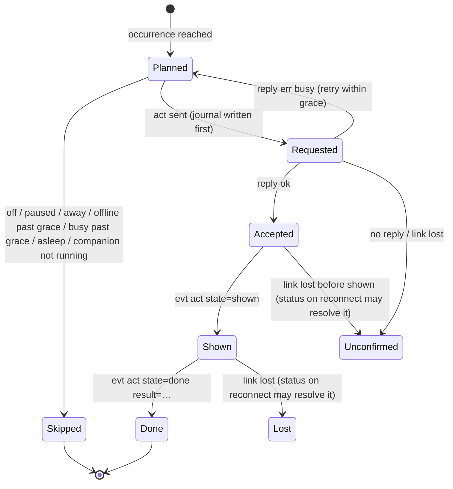

# Schedule, interactions and history: design

Status: P1–P3 built on `feature/schedule` (engine, `schedule.json`, the Schedule page with drag-and-drop). Everything
below "P4" is design, approved direction but not built. The Companion is the scheduling brain; firmware and
simulator only show, ask and report (they share `components/app`, so every protocol addition lands in both).

## 1. Three separate concepts

| Concept | Meaning | Who acts | Evidence of real life? |
|---|---|---|---|
| **Mood** | How Buddy looks during an interval (`working`, `sleepy`, …) | Buddy (device) | Never |
| **Action** | Something Buddy does at a moment: an animation, or an interactive question with an answer | Buddy (device), started by the schedule | Only the answer to an interactive question, and only once it was confirmed on screen |
| **Plan** | What you intend to do (`smoke`, `coffee`, `meeting`, …) | Nobody: an intention | Never; compared with actual history later |

A block may have any combination. Real-world activity is recorded only from explicit statements: an answer to a
question, a MY DAY tap on the touchscreen, a Companion quick-log button. Buddy's entertainment shows (Activities,
Food & Drink animations) never create history.

### Block (schedule.json, version 2)

```json
{"id": "…", "name": "Smoke break", "start": "10:00", "end": "10:12",
 "mood": null, "action": "ask_peukie", "plans": "smoke", "reminder": false, "enabled": true}
```

`action` is new (null: none). It fires once, at the block's start (see §4). Version 2, because a version-1 Companion
would drop `action` when it saves; a v1 file loads into v2 unchanged.

### Scheduled actions: an allowlist in the Companion

| id | Kind | Sent as | Results |
|---|---|---|---|
| `ask_peukie` | interactive question (the existing "PEUKIE ROKEN?", same code path as the touchscreen menu) | `act name=ask_peukie iid=…` | `yes`, `no`, `timeout` |
| `sneeze`, `stare`, `meditate`, `focus`, `water` | animation | `act name=… iid=…` | `done`, `interrupted` |

Only ids in this list can be stored in `action` and sent by the scheduler. PDC Manager, Teams, messages, mode
changes and anything else with an external effect are not in it, and the device has no command that could do them
from `act` anyway.

## 2. Protocol additions (P4)

All backward compatible: unknown arguments and events are ignored on both sides; the Companion checks `hello caps=`.

| Addition | Purpose |
|---|---|
| `act name=<n> iid=<1..4294967295>` | `iid` correlates the request with what follows. Reply `ok` = started on the device this frame; `err busy mode=<m>` = not started (Clock Mode, a zoom, another activity or question, screen not lit) |
| `acts=` gains `ask_peukie` | The existing question can be started by command (today: touchscreen only) |
| `evt act iid=<n> name=<a> state=shown src=<cmd\|touch>` | Sent after the first frame showing it has been presented: the question is really on screen |
| `evt act iid=<n> state=done result=<yes\|no\|timeout\|done\|interrupted>` | The end. `timeout` and `no` are distinct (the brain knows whether the minute ran out or NEE was pressed), although Buddy reacts the same way to both |
| `status` gains `act=<iid>:<state>[:<result>]` | The current or last interaction, so a reconnect can close a record whose events were lost |
| `evt mood … src=<cmd\|touch\|timer\|break>` | Why the mood changed: a manual override is then a rule, not a guess |
| `evt did item=<menu item id>` | MY DAY taps (explicit activities); never sent for things the Companion commanded |
| cap `track` | The firmware does the above; without it the Companion schedules no actions (moods only) |
| P4.1, cap `log`: `dev=`/`boot=` in `hello` and `evt boot`; `seq=` and `t=<UTC ms>` or `up=<ms>` on `evt act` and `evt did`; `log.since boot= seq=` | Events from while the Companion was away come back after a reconnect, each with a permanent identity and its own time (see `docs/protocol.md`, *Recorded events*) |

Touch-started questions get an iid from the device (top bit set), so the device's and the Companion's ids never
collide. The question keeps its **60 s** window (`BUDDY_ASK_MS`; decided). Approved: grace periods of 3 min for
questions and 1 min for animations; the scheduled-action allowlist above (Monster stays out); the four Pause presets.

## 3. Interaction lifecycle and records



**Interaction journal:** `interactions.jsonl`, append-only, one line per state change. A simulator connection
writes `interactions.sim.jsonl` instead.

```json
{"v":1,"id":"<guid>","occ":"<block id>/2026-10-16","action":"ask_peukie","iid":2981223,"state":"shown",
 "at":"2026-10-16T10:00:01.412+02:00","src":"board","meta":{"fw":"d36d8f0"}}
```

A record is the fold of its lines. It holds the interaction id, occurrence and block, action, scheduled time,
display time (from `shown`), response and response time, the outcome, the source (board or simulator) and
diagnostics.

**Outcomes and what they may mean later:**

| Outcome | Counts as behaviour? |
|---|---|
| `yes`, `no` (shown) | yes |
| `timeout` (shown) | yes, but weaker: you may not have been at the desk |
| `done`, `interrupted` (animations) | no (Buddy's show) |
| `skipped:<reason>`, `unconfirmed`, `lost` | no: an offline device, a pause or a busy Buddy is not you ignoring him |

**No duplicates:**
- The `requested` line is written before `act` is sent.
- The occurrence id is checked before every attempt, so a restart, reconnect or retry never sends twice.
- Events are matched by iid; a repeated event for a finished iid changes nothing.

**Manual activity:** `activities.jsonl` (and `.sim.jsonl`).

```json
{"v":1,"id":"<guid>","type":"smoke","started_at":"…","ended_at":null,"source":"board|simulator|companion",
 "via":"interaction:<id>|myday:food.coffee|companion","meta":{}}
```

- *JA* to the question records `smoke` started at the answer time, linked to the interaction.
- A later MY DAY "Smoke" at 10:25 is a separate record.
- `ended_at` is optional and only set by an explicit end, for example MY DAY "Back to work".

## 4. When an action runs (ActionScheduler, P6)

**Occurrence id:** `<block id>/<local date>`.
- One action per block per day: a restart, the repeated DST hour or a reconnect cannot run it twice.
- A block starting in the skipped DST hour runs at the first existing minute.
- Moving the block later the same day, before it ran, keeps the id, so it runs at the new time. Once it ran, it does
  not run again that day.

**At the start time:** the occurrence is due for a grace period of 3 minutes for questions and 1 minute for
animations.

| Situation | Decision |
|---|---|
| Schedule off, paused or away | Skip now (`skipped:paused` etc.) |
| Device not connected | Wait; if it connects within the grace period, run; else `skipped:offline` |
| Device busy (Clock Mode or its zoom, Monster, an activity, another question, screen dark) | Retry every 10 s within the grace period; else `skipped:busy:<mode>`. Clock Mode and the zoom are never interrupted |
| Companion was not running at the start time | On start: `skipped:companion_off` for today's passed occurrences, never run late |
| PC was asleep through the start time | On wake: `skipped:asleep` |
| Otherwise | Run now |

Old questions are never queued after an absence: past the grace period an occurrence is only ever recorded as
skipped. A mood override does not block actions (moods and actions are independent).

**Pause / Away (P6 minimal, P7 presets):** one control in the Schedule header with *1 hour*, *rest of today*,
*until I resume* and *N days (holiday)*.
- Stored as `pausedUntil` in `schedule.json`.
- While paused: no actions (recorded as `skipped:paused`) and no scheduled mood transitions. Resuming applies the
  current scheduled mood, like *Resume schedule*.
- Paused days are excluded from all statistics.

## 4b. Reliability and later synchronisation (requirements, binding for P5 on)

- **Incomplete data stays incomplete.** An interaction whose outcome cannot be established (no reply, no `shown`, the
  link lost and `status act=` reports another or no interaction) is recorded as `unconfirmed` or `lost`, never as
  `no`, `timeout` or anything else that claims behaviour. The device itself never turns an interruption into an
  answer (`interrupted`, host-tested).
- **No duplicates.** Retries reuse the `iid` (the device answers `ok dup=1` and starts nothing). Every device event
  is keyed by `(dev, boot, seq)`; storing is an idempotent upsert on that key, so a live copy and any number of
  replayed copies (`replay=1`, identical apart from that flag) give one record. Answered questions are additionally
  folded per interaction id.
- **Replay checkpoint (P5).** The Companion keeps, per `(dev, boot)`, the highest `seq` it has stored, and advances it
  only after the event lines up to that `seq` are durably written (appended and flushed to disk). After every
  `hello` (and on a jump in the live `seq`) it sends `log.since boot=<b> seq=<checkpoint>`; with a new `boot` it
  asks from 0. A crash between storing and advancing re-fetches events already stored: harmless by the key above. It
  never advances past an event it has not stored. `lost=<k>` in the reply, and a `boot` that ended with events never
  fetched, are written as explicit gap records (count known or unknown), never as invented activity.
- **Device time.** A `t=` event stores that UTC time (and the local time and offset derived from it on the
  Companion). An `up=` event (the clock was not set yet) stores `time_known=false` with `boot` and `uptime_ms`, never
  a date guessed from the reception time; P5 records must be able to hold both forms.
- **Installation id.** Each Companion installation gets a stable random id (stored next to the journals, created on
  first use); every record carries it.
- **Globally unique ids.** Records use GUIDv7 ids (time-ordered); an occurrence id is `<installation>/<block id>/<local
  date>` once several installations exist, so a merge sees one occurrence once.
- **Unambiguous time.** Every record stores UTC (`at_utc`) and the local time with its offset (`at`), plus the
  Windows time zone id the occurrence was evaluated in; local wall-clock time drives the schedule, UTC orders events.
- **Mergeable journals.** Append-only, one fact per line, never rewritten: merging installations is a union by id,
  folding per interaction id; corrections are new lines (`_retract`), not edits.
- **At most once per local calendar day**, the repeated DST hour included: the occurrence id is per local date and is
  written before the action is sent (P6).
- Not built yet: any server, remote control or synchronisation.

## 5. Later: patterns and suggestions (not authorized yet)

`PatternAnalyzer` only reads the journals; `SuggestionEngine` turns findings into proposals.

- **Evidence:** only shown questions (`yes`, `no`, `timeout`) and explicit activities count. Days that were paused,
  offline, skipped or with the Companion off are left out, so a holiday proves nothing (Example C).
- **Unnecessary activity (Example A):** for each recurring question, count yes, no and timeout over the last N
  occurrences that were shown.
- **Wrong timing (Example B):** take the explicit activities of the plan's type within ±90 minutes of the occurrence
  and compute their median offset and spread.
- **Explanation (Example D):** every suggestion carries its numbers, for example "accepted 2 of 12 shown on weekdays;
  a manual smoke break between 10:20 and 10:40 on 9 of those days".
- **Approval and provenance:** a suggestion changes nothing until you approve it.
  - `suggestions.jsonl` keeps each one (`proposed` / `accepted` / `dismissed`).
  - `schedule-changes.jsonl` records every saved edit with its origin (`manual` or `suggestion:<id>`).
  - Nothing is moved, disabled or deleted silently.

## 6. Roadmap

Reliable persistence must exist before scheduled actions go live: an action sent without its `requested` line first
could repeat after a crash, and its result would be lost. So the journals come before live scheduling.

| Phase | Scope | Acceptance |
|---|---|---|
| P3 (done) | Engine, `schedule.json`, Schedule page, drag-and-drop | 112 tests; drag verified in the running app |
| **P4** Protocol + firmware (done, on `feature/schedule`) | `act iid=`, `ask_peukie` in `acts=`, `evt act shown/done`, `status act=`, `evt mood src=`, `evt did`, MY DAY page, caps `track,did`; the Companion needs no change (it ignores unknown events and lists no `ask_peukie` tile) | 93 host tests incl. the application end to end on a fake platform; the simulator smoke-tested over TCP; firmware builds without warnings; on the board (`2a0c261`): question by command, JA / NEE / timeout distinct, Clock Mode interrupts and refuses, MY DAY all seven, Clock zoom unchanged (0 resyncs), Companion connects |
| **P4.1** Recorded events (done, on `feature/schedule`) | Identity `(dev, boot, seq)` (MAC / machine hash, 64-bit boot id from a true entropy source), event time `t=` or `up=`, the last 64 events in PSRAM, `log.since` replay (2 lines per frame, reply after the last, `lost=` on overflow), cap `log`; no flash writes; `evt did n=` replaced by `seq=` | 97 host tests (identity and time, replay without duplicates, repeat replay identical, other boot, one replay at a time, overflow `lost=`); simulator: events from while disconnected replayed with their own time; **board not flashed** |
| **P5** Journals | `interactions.jsonl`, `activities.jsonl` (+`.sim`), InteractionTracker (iid correlation, `status` reconciliation, dedup), manual records (touch question, MY DAY, Companion quick-log) | Unit tests for folding, dedup and torn last lines; in the simulator one question gives exactly one record with the right outcome; a JA gives one `smoke` activity; simulator records never reach the real files |
| **P6** Live scheduling | MoodDirector wired; ActionScheduler (occurrences, grace, availability, skips); `action` in the editor (schedule v2); Pause | In the simulator: a block a minute ahead sends one `mood.set`; `ask_peukie` asks once and records yes, no or timeout; Clock Mode gives `skipped:busy:office` and is not interrupted; a disconnect past grace gives `skipped:offline`; a restart does not ask again |
| **P7** History + polish | History page (today, this week, outcomes), Away presets, optional reminders, DPI pass (125/150 %), regression tests | Screenshots at 3 DPIs; history matches the journals |
| Future | PatternAnalyzer, SuggestionEngine, edit provenance | Separate approval |
